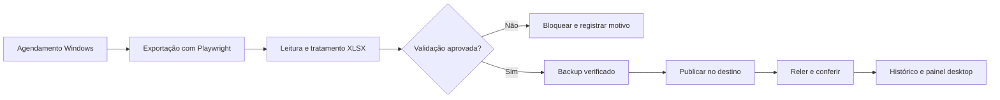

# Do quadro à base validada

## Problema

Uma base de acompanhamento precisa refletir os registros do quadro de trabalho. Exportar, limpar e publicar manualmente cria etapas repetitivas e exige atenção para não substituir o destino por uma exportação incompleta ou inválida.

## Contribuição

Criação e aprimoramento de uma rotina de coleta com Playwright, tratamento de XLSX com openpyxl, validações, backups e acompanhamento de execução. O agendamento no Windows aciona a rotina quando as condições operacionais estão disponíveis. Antigravity e OpenAI Codex apoiaram o desenvolvimento profissional.

## Evolução documentada

1. **Etapa anterior:** atualização de base Excel sincronizada por OneDrive/SharePoint.
2. **Evolução registrada em outubro/2026:** publicação da base validada pela API Google Sheets, com backup local e releitura do destino.

As descrições dessas etapas não devem ser misturadas. A coleta continua baseada em exportação pelo navegador, sem uso da API do monday.com para alterar o quadro.

## Escolhas representadas na demonstração

- **Conferir antes de aplicar:** a execução padrão não altera o destino.
- **Preservar informação:** nomes repetidos e IDs vazios não são eliminados automaticamente.
- **Interromper com motivo:** duplicidade de ID preenchido bloqueia a publicação.
- **Permitir recuperação:** backup com hash antes da substituição de um destino existente.
- **Mostrar o resultado:** painel e relatório diferenciam sucesso de bloqueio.

A demonstração reduz o esquema a cinco colunas e três registros fictícios. Não reproduz as exceções, integrações, regras de negócio ou infraestrutura da versão profissional.

## Resultado descrito com precisão

A rotina profissional elimina as etapas manuais da atualização quando as condições de execução estão disponíveis. Não se atribui aqui uma nova porcentagem de redução do tempo de processamento. Os horários, contagens e exemplos do painel público são fictícios.
