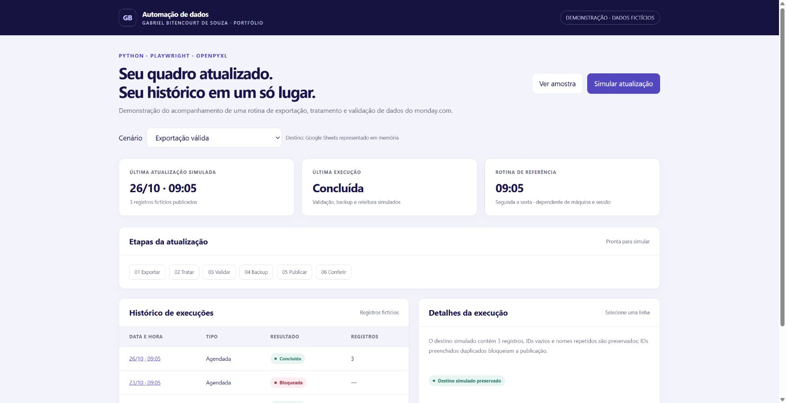

# Automação de dados do monday.com — demonstração

Uma rotina de dados precisa produzir um resultado confiável e explicar quando não pode prosseguir. Esta demonstração apresenta exportação, tratamento, validação, backup e acompanhamento de execução com **dados inteiramente fictícios**.

**[Abrir demonstração interativa](https://gabrielbsouza15.github.io/monday-data-automation-demo/)** · [Estudo de caso](CASE_STUDY.md) · [Python](demo.py) · [Testes](test_demo.py)



## O que este repositório executa

- `demo.py`: gera um XLSX fictício, remove linhas estruturais, valida cabeçalhos e IDs e preserva registros sem ID e materiais com nomes repetidos.
- Conferência como padrão. `--aplicar` grava exclusivamente um JSON local, que representa o destino tabular.
- Antes de substituir um destino existente: backup conferido por SHA-256 e verificação de mudança do destino. Depois: releitura do conteúdo publicado.
- IDs preenchidos duplicados ou fórmulas inesperadas bloqueiam o processamento.
- `docs/`: painel web interativo com cenário válido, cenário bloqueado, histórico e amostra para download. A simulação visual usa memória do navegador; não executa Python nem acessa serviços externos.
- `collect_demo.py`: exemplo opcional de coleta com Playwright, limitado a uma página fictícia em localhost.

## Executar o processamento local

Requer Python 3.10+ e as dependências de `requirements.txt`.

```bash
python -m pip install -r requirements.txt
python demo.py
python demo.py --aplicar
python demo.py --cenario duplicado --aplicar
python -m unittest -v test_demo.py
```

O terceiro comando bloqueia a escrita por duplicidade e termina com código 2. Os arquivos ficam em `demo_output/`, dentro deste projeto. O exemplo não lê a pasta Downloads, não acessa contas e não conhece IDs, caminhos ou dados de produção.

## Abrir o painel

```bash
python -m http.server 8000 --bind 127.0.0.1 --directory docs
```

Abra `http://127.0.0.1:8000/`. A interface também pode ser hospedada no GitHub Pages a partir de `main /docs`.

## Coleta opcional com Playwright

Com o servidor local acima em execução:

```bash
python -m pip install -r requirements-browser.txt
python -m playwright install chromium
python collect_demo.py
```

O coletor aceita apenas HTTP em localhost e usa um contexto novo, sem perfil ou autenticação. O XLSX de exemplo pode ser obtido também pelo link da interface. O script Playwright é um exemplo preparado; sua execução automatizada não foi validada nesta sessão de preparação. A navegação e o download da página de exemplo foram conferidos separadamente pelo navegador.

## Relação com o projeto profissional

Criei e aprimorei uma automação profissional em Python, Playwright e openpyxl, com apoio do Antigravity e OpenAI Codex. A solução evoluiu de atualização de Excel sincronizado por OneDrive/SharePoint para publicação pela API Google Sheets, mantendo controles, histórico, painel desktop e agendamento no Windows.

Este repositório é uma **recriação independente para portfólio**. O painel web adapta as funções do painel desktop. A publicação Google é representada por um JSON local; não há OAuth, acesso ao monday.com, chamadas Google ou configuração de agendamento. Os testes comprovam somente o escopo desta demonstração. Não são medições de resultado profissional.

## Decisões e limites

O projeto profissional depende de máquina, rede e sessão autenticada na coleta. Eliminar etapas manuais não equivale a reduzir a zero o tempo de processamento. O backup demonstrado é local e não representa uma cópia completa de uma planilha Google. A verificação de alteração externa reduz riscos no exemplo, mas não é uma transação distribuída nem um bloqueio de escrita entre múltiplos processos.

Nenhum dado, credencial, perfil de navegador, log, backup, link interno ou logotipo profissional foi incluído. Código desta demonstração preparado com apoio do OpenAI Codex, sob orientação de Gabriel Bitencourt de Souza.

## Autor

[Gabriel Bitencourt de Souza](https://www.linkedin.com/in/gabrielbitencourtdesouza/) · Dados, BI e automação · Engenharia de Produção em andamento na UFV.

Código demonstrativo disponibilizado sob licença MIT. A licença abrange somente o conteúdo deste repositório.


## Verificação automática

O workflow executa os testes do processamento Python em Linux com Python 3.12. Ele não executa a coleta opcional com Playwright nem serviços profissionais. A execução ocorre em alterações de `main`, pull requests e acionamentos manuais. Consulte o resultado em [GitHub Actions](https://github.com/GabrielBSouza15/monday-data-automation-demo/actions/workflows/testes.yml).
